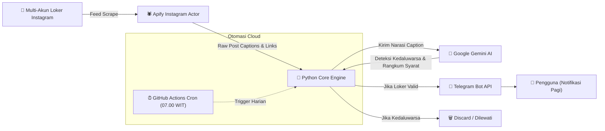

<div align="center">

# 🤖 Radar Loker Ternate
### Autonomous AI-Powered Job Hunter & Telegram Notification Bot

[](https://www.python.org/)
[](https://ai.google.dev/)
[](https://apify.com/)
[](https://core.telegram.org/bots/api)
[](https://github.com/features/actions)
[](LICENSE)

<p align="center">
  Agen cerdas tanpa server (serverless) yang memindai kanal info lowongan kerja Instagram Kota Ternate secara otomatis, menyaring tanggal kedaluwarsa dengan kecerdasan buatan <b>Google Gemini</b>, dan mengirimkan ringkasan instan ke Telegram setiap pagi.
</p>

</div>

---

## 📑 Daftar Isi
- [Latar Belakang & Masalah](#-latar-belakang--masalah)
- [Arsitektur & Alur Kerja](#-arsitektur--alur-kerja)
- [Fitur Utama](#-fitur-utama)
- [Tech Stack](#-tech-stack)
- [Petunjuk Penggunaan Lokal](#-petunjuk-penggunaan-lokal)
- [Konfigurasi GitHub Secrets (Otomasi Cloud)](#-konfigurasi-github-secrets-otomasi-cloud)
- [Struktur Proyek](#-struktur-proyek)
- [Kontributor & Lisensi](#-kontributor--lisensi)

---

## 💡 Latar Belakang & Masalah

Mencari lowongan pekerjaan di media sosial (seperti Instagram) sering kali memakan waktu:
1. Format teks caption postingan panjang dan tidak terstruktur.
2. Banyak postingan pamflet yang batas waktu lamarannya (deadline) sudah terlewat / usang.
3. Pencari kerja harus mengecek manual banyak akun setiap harinya.

**Radar Loker Bot** hadir sebagai solusi otomasi menyeluruh: memindai multi-akun publik secara terjadwal, menyerahkan analisis teks ke model AI bahasa besar (*LLM*) untuk menyaring batas waktu dan merangkum poin penting, serta mengirimkan laporan langsung ke aplikasi pesan Telegram Anda.

---

## 🏗 Arsitektur & Alur Kerja



---

## 🚀 Fitur Utama

* **Multi-Source Scraping:** Memindai berbagai portal loker regional (Ternate & Maluku Utara) secara bersamaan melalui platform Apify.
* **AI Smart Filter (Google Gemini):**
  * Mengenali tanggal batas akhir pendaftaran secara kontekstual.
  * Secara cerdas mengeliminasi postingan yang sudah lewat waktu (*expired detection*).
  * Menghasilkan ringkasan terstruktur: **Kategori Industri**, **Nama Posisi**, dan **Syarat Kunci**.
* **Instant Telegram Alert:** Notifikasi berformat HTML rapi yang dilengkapi tautan langsung ke postingan asli.
* **100% Serverless & Gratis:** Berjalan sepenuhnya di awan menggunakan **GitHub Actions Cron**, tanpa memerlukan sewa server atau VPS bulanan.
* **Rate-Limit & Error Handling:** Dilengkapi mekanisme proteksi jeda waktu (*graceful backoff*) agar tidak terkena limit kuota API.

---

## 🛠 Tech Stack

| Komponen | Layanan / Teknologi | Fungsi |
| :--- | :--- | :--- |
| **Bahasa Pemrograman** | Python 3.10+ | Bahasa inti pemrosesan data & integrasi |
| **Kecerdasan Buatan** | Google Gemini API (`google-genai`) | Ekstraksi informasi, pemfilteran & peringkasan |
| **Web Data Extraction** | Apify Client (`apify-client`) | Ekstraksi feed & caption akun Instagram |
| **Notification Engine** | Telegram Bot API (`requests`) | Pengiriman notifikasi push ke perangkat seluler |
| **Cloud Scheduler** | GitHub Actions Workflow | Eksekusi terjadwal harian (cron trigger) |
| **Manajemen Environment** | `python-dotenv` | Pengamanan token & kredensial API |

---

## ⚙️ Petunjuk Penggunaan Lokal

### 1. Clone Repositori:
```bash
git clone https://github.com/owensavala/radar-loker-bot.git
cd radar-loker-bot
```

### 2. Buat & Aktifkan Virtual Environment:
```bash
python -m venv venv

# Windows:
venv\Scripts\activate

# Linux / macOS:
source venv/bin/activate
```

### 3. Install Dependensi:
```bash
pip install -r requirements.txt
```

### 4. Konfigurasi Variabel Environment:
Salin berkas template `.env.example` menjadi `.env`:
```bash
cp .env.example .env
```
Isi nilai-nilai variabel di dalam `.env`:
```env
APIFY_TOKEN=token_apify_anda
TELEGRAM_TOKEN=token_bot_telegram_dari_botfather
CHAT_ID=id_chat_telegram_anda
GEMINI_API_KEY=kunci_api_google_gemini_anda
GEMINI_MODEL=gemini-2.5-flash
```

### 5. Jalankan Bot:
```bash
python radar_loker.py
```

---

## 🔐 Konfigurasi GitHub Secrets (Otomasi Cloud)

Agar bot dapat berjalan secara otomatis setiap hari di GitHub Actions tanpa mengekspos token rahasia ke publik:

1. Buka repositori ini di GitHub: `https://github.com/owensavala/radar-loker-bot`
2. Masuk ke **Settings** > **Secrets and variables** > **Actions**.
3. Klik tombol **New repository secret** dan tambahkan 4 kunci rahasia berikut:
   * `APIFY_TOKEN` : Token dari dashboard Apify Anda.
   * `TELEGRAM_TOKEN` : Token bot Telegram Anda dari `@BotFather`.
   * `CHAT_ID` : ID Telegram penerima pesan.
   * `GEMINI_API_KEY` : Kunci API Google AI Studio Anda.
4. Bot akan otomatis dijalankan setiap hari pada pukul **07:00 WIT (22:00 UTC)**, atau dapat dipicu secara manual kapan saja melalui menu tab **Actions** > **Run workflow**.

---

## 📂 Struktur Proyek

```text
radar-loker-bot/
├── .github/
│   └── workflows/
│       └── jadwal_bot.yml       # Konfigurasi penjadwalan GitHub Actions
├── .env.example                 # Template variabel environment
├── .gitignore                   # Mengabaikan .env dan cache Python
├── LICENSE                      # Lisensi resmi open-source (MIT)
├── README.md                    # Dokumentasi lengkap proyek
├── radar_loker.py               # Skrip logika pemrosesan utama
└── requirements.txt             # Daftar pustaka Python yang dibutuhkan
```

---

## 👨‍💻 Pengembang

* **Muh. Sattar Barakati** ([@owensavala](https://github.com/owensavala)) - *Creator & Maintainer*

---

## 📄 Lisensi

Proyek ini dilisensikan di bawah [MIT License](LICENSE) - bebas digunakan dan dikembangkan untuk keperluan edukasi dan pencarian kerja nirlaba.
